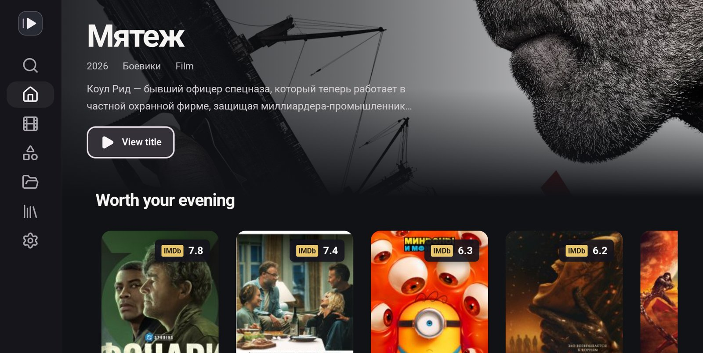
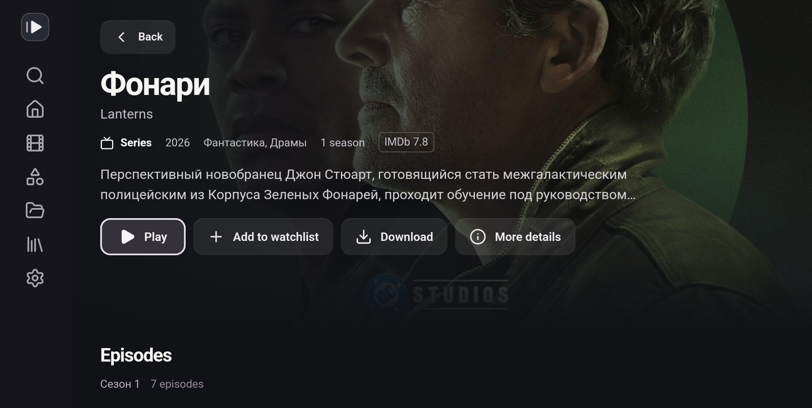
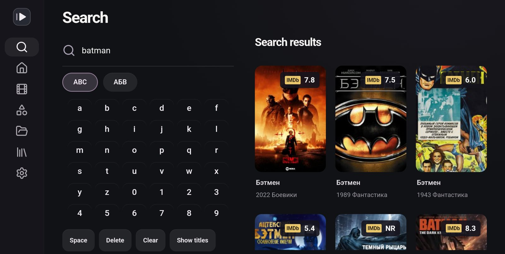
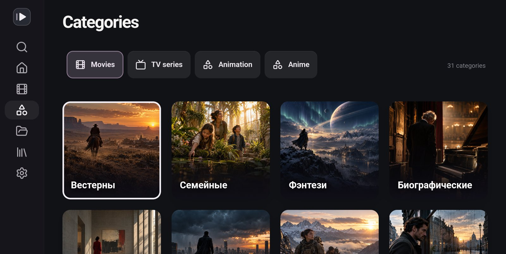
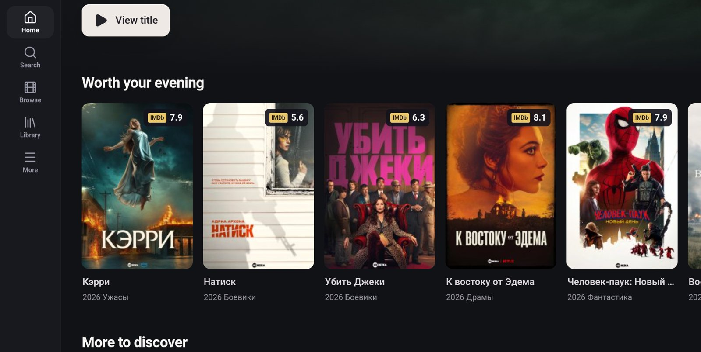
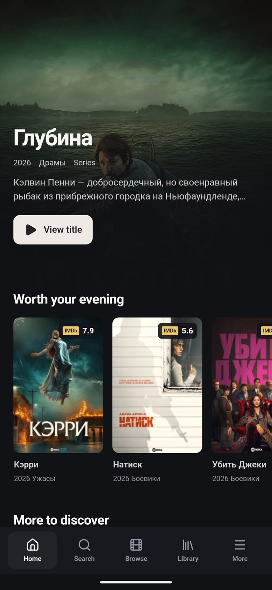
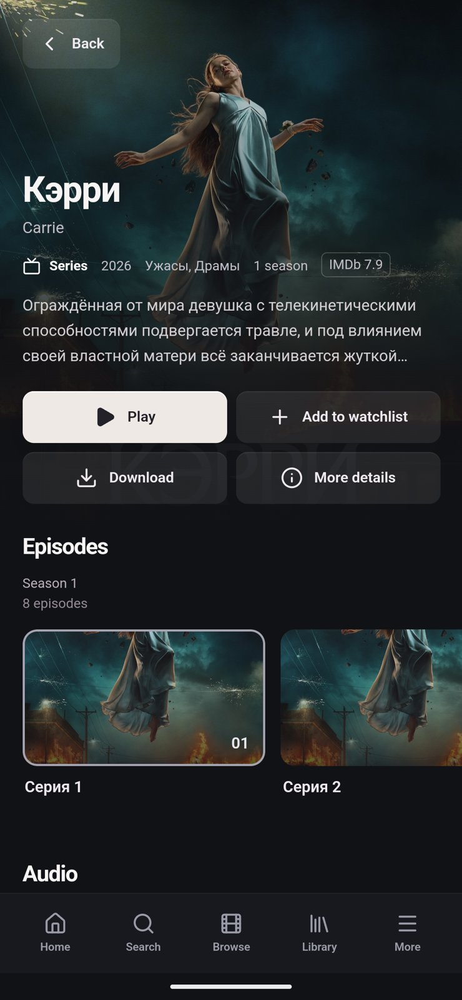

# Rezka: HDRezka app for Android, Android TV and Google TV

**An unofficial HDRezka client that lets you watch the films and series from the HDRezka website in a Netflix-style experience, like a premium streaming platform.** It tracks the films and episodes you have watched, so you can continue exactly where you left off. It works on any Android device: phones, tablets, Android TV, Google TV, Chromecast with Google TV, Fire TV and TV boxes.

The layout adapts to each device. Phones and tablets get touch controls, and TVs get a remote friendly interface.

<p align="center">
  
  
  
  
</p>
<p align="center">
  
  
  
</p>

Looking for iPhone? See [rezka-ios](https://github.com/lastrowcritic/rezka-ios).

## Disclaimer

This project is only a client. It does not host, upload, store or distribute any films, series or other media. Everything you see in the app is loaded directly from the third party HDRezka website. We are not affiliated with that website and are not responsible for its content, its availability or how it is used. You are responsible for following the laws of your country when using it.

## What it does

- **Browse** the live catalogue: new releases, popular titles, genres, categories and collections.
- **Search** with Latin and Cyrillic keyboards, including an on-screen keyboard for the TV remote.
- **Title pages** with poster, rating, description, cast and crew, comments, franchises and related titles.
- **Choose** the voice-over (translation), season, episode and video quality.
- **Watch** in a native video player with seeking, quality switching, subtitles and media remote buttons.
- **Continue watching** from exactly where you stopped. Each episode remembers its own position.
- **Autoplay** the next episode after a short countdown, even across seasons. You can turn it off.
- **Download** films and episodes to watch offline.
- **Hide countries** you are not interested in, across the whole app.
- **Watchlist**, viewing history and your own video links.
- **Updates itself.** The app tells you when a new version is published here and installs it in one step.

All of your data stays on your device. The app has no accounts, no analytics and no server of its own.

## Install

Download the latest `.apk` file from [Releases](https://github.com/lastrowcritic/rezka-android/releases/latest).

- **Phone or tablet:** open the downloaded file and allow installing apps from that source when asked.
- **Android TV / Google TV:** install a file manager or the "Downloader" app on the TV and open the `.apk` from there. You can also install from a computer with `adb install Rezka-<version>.apk`.

The app requires Android 7.0 or newer.

## How it works

The interface is a React web app running inside a native Android shell ([Capacitor](https://capacitorjs.com)). Everything that needs the device, such as networking, the video player, downloads and website checks, is handled by native Android code.

1. **Finding a working website address.** HDRezka is available on many mirror domains, and some are blocked in some countries. When the app starts, it downloads the list in [`mirrors.json`](mirrors.json) from this repository and picks the first mirror that responds. You can also choose a mirror yourself in Settings.
2. **Reading pages.** The app downloads the website's HTML pages and reads the titles, posters and details from them.
3. **Getting the video.** When you press play, the app asks the website for the video links, in the same way the website's own player does. The website hides those links in an encoded form. The app decodes them and plays the video with Android's Media3 player.
4. **Website checks.** Sometimes the website shows a "checking your browser" page. The app opens it in a normal browser window, waits for it to finish and then continues. If the page needs you, for example to tick a box, it is shown to you.

Your progress is saved every few seconds while you watch, and when you pause or leave the player.

## Build it yourself

You need:

- Node.js 24
- Java 21 or newer
- The Android SDK with Platform 36 and Build Tools 35 (installed with [Android Studio](https://developer.android.com/studio))

Set `ANDROID_HOME` to your SDK folder if it is not in the standard location. Then run:

```sh
npm ci
npm run android:build
```

This creates `Rezka-<version>-debug.apk` in the project folder.

To build a signed release APK instead, create a keystore once and set these variables before building:

```sh
keytool -genkeypair -v -keystore rezka.jks -alias rezka -keyalg RSA -keysize 4096 -validity 10000
export REZKA_KEYSTORE="$PWD/rezka.jks" REZKA_KEY_ALIAS=rezka
export REZKA_KEYSTORE_PASSWORD='...' REZKA_KEY_PASSWORD='...'
npm run android:build
```

Keep the keystore safe and out of the repository. Android only installs an update when it is signed with the same key as the installed app.

### Try the interface on a computer

```sh
npm ci
npm run dev
```

Then open http://127.0.0.1:5173/?preview=1. Arrow keys move, Enter selects, Escape goes back. Preview mode uses sample titles. You can switch to the live catalogue in Settings, but website checks only work in the Android app.

### Run it in the Android TV emulator

```sh
npm run tv
```

This starts an Android TV emulator, then builds, installs and opens the app. It needs the Android TV system image in your Android SDK.

## Tests

```sh
npm test
```

These tests check page parsing, video link decoding, mirror switching, remote control navigation and saved progress against sample data, so no internet connection is needed. `npm run test:live` runs the same checks against the real website.

## Project layout

| Folder | What is inside |
| --- | --- |
| `src` | The interface: screens, navigation and styles |
| `src/core` | Website access: mirrors, page parsing, video link decoding, saved history |
| `src/components` | Shared interface parts such as cards and the browser preview player |
| `android/app/src/main/java` | Native Android code: video player, downloads, networking and website checks |
| `tests` | Automated tests |
| `scripts` | Build and emulator helpers |

## Updating the mirror list

Edit [`mirrors.json`](mirrors.json) and push to the `main` branch. Installed apps download the new list the next time they start.

## Keywords

HDRezka app, HDRezka client, HDRezka Android, HDRezka Android TV, HDRezka Google TV, Rezka APK, HDRezka APK, watch films and series on Android TV, unofficial HDRezka player. Приложение HDRezka для Android и Android TV, клиент HDRezka (Rezka, Резка), смотреть фильмы и сериалы на телевизоре, продолжить просмотр с того же места.

## Known limits

The website can change its layout or its video encoding at any time, which can break parts of the app until it is updated.
